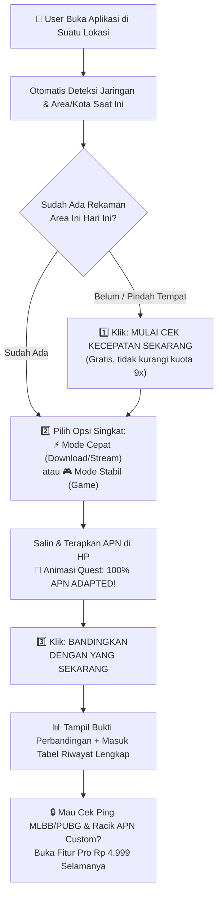

# 📋 Juru Speedtest — Dokumentasi & Alur Sistem (Sesuai Hasil Review)

---

## ✅ 1. Ringkasan Perubahan Sesuai Review

1. **Kuota Uji Coba Gratis = 9x** (`freeTrialLimit: 9`), dengan aturan cerdas berbasis **Area & Hari**:
   - **Tes Kecepatan Pertama (Rekam Area & Jaringan Hari Ini)** = **GRATIS & TIDAK mengurangi kuota 9x!**
   - Jika masih di jaringan & area/kota yang sama pada hari yang sama, rekaman awal tetap tersimpan otomatis dan user tinggal menguji perbandingan APN.
   - Jika berpindah tempat/kota atau ganti hari, sistem otomatis mendeteksi **Area Baru** dan mengajak user merekam kecepatan di tempat baru tersebut.
2. **Header Lebih Bersih & Fitur Durasi (`Cepat / Presisi`) Dijadikan Mode Advanced (Pro):**
   - Tombol `Install Aplikasi (PWA)` dihapus agar header bersih.
   - Pilihan durasi `Cepat` & `Presisi` diberi ikon gembok 🔒 untuk user gratis (klik langsung buka modal Pro), sementara `Standar` aktif default.
3. **Deteksi Jaringan & Area 100% Otomatis:**
   - Deretan tombol 8 kartu SIM di halaman utama dihapus (karena tidak relevan mengecek jaringan operator lain tanpa ganti kartu fisik).
   - Hanya menampilkan **Jaringan & Area/Kota yang sedang terbaca otomatis saat ini**.
4. **Opsi APN di Awal Singkat, Padat, & Jelas:**
   - **⚡ Opsi 1 • Mode Cepat:** *Fokus kecepatan download file besar & streaming YouTube/TikTok HD lancar.*
   - **🎮 Opsi 2 • Mode Stabil:** *Fokus ping kecil & sinyal 4G LTE rata agar anti-lag saat main game.*
5. **Animasi Quest "100% APN Adapted" + Tombol "Bandingkan dengan yang Sekarang":**
   - Setelah user memilih & menyalin APN, muncul progress bar **100% APN Adapted** dan tombol **"Bandingkan dengan yang Sekarang"**.
6. **Riwayat Pengujian Lokal Super Lengkap (Langsung di Atas Panel Pro):**
   - Menampilkan: **Waktu & Tahap (`SEBELUM` / `SESUDAH CEPAT` / `SESUDAH GAME`)**, **Nama & Kode APN + Protokol**, **Download Mbps + Pemakaian Data (MB)**, **Upload Mbps + Pemakaian Data (MB)**, **Ping / Jitter / Packet Loss**, serta **Skor & Bufferbloat**.
7. **Game Ping Radar & APN Optimizer Lab Dijadikan Fitur Pro (Spill Transparan + Gembok):**
   - Untuk user gratis, kedua panel ini ditampilkan secara **transparan/blur halus dengan gembok Pro** (*spill tampilan*) sehingga membuat penasaran untuk upgrade Rp 4.999 Selamanya.

---

## 🔘 2. Daftar Button Utama (Setelah Disederhanakan)

### 🔷 Header (`Header.tsx`)
| Kode | Label Tombol | Status | Fungsi |
|---|---|---|---|
| `H1` | Logo **JuruSpeedtest + Badge Area** | Semua User | Kembali ke tampilan utama |
| `H2` | **Standar** / 🔒 **Cepat** / 🔒 **Presisi** | Advanced (Pro) | Ganti durasi tes (terkunci untuk user gratis) |
| `H3` | **Mbps / MB/s** | Semua User | Ganti satuan kecepatan |
| `H4` | **Gratis X/9 • Pro Rp 4.999** | Semua User | Buka modal upgrade Pro Selamanya |
| `H5` | **☀️ / 🌙** | Semua User | Ganti tema Terang / Gelap |

### ⚡ Speedometer & Alur 3 Langkah (`SpeedometerGauge.tsx` & `BeforeAfterComparisonPanel.tsx`)
| Kode | Label Tombol | Kapan Muncul | Fungsi |
|---|---|---|---|
| `S1` | **▶ MULAI CEK KECEPATAN SEKARANG** | Belum ada rekaman area hari ini | Merekam kecepatan awal & area (tidak kurangi kuota 9x di hari yg sama) |
| `S2` | **↺ BANDINGKAN DENGAN YANG SEKARANG** | Sudah ada rekaman awal di area ini | Menguji kecepatan sesudah ganti APN & membandingkan hasilnya |
| `C1` | **↗ Salin & Terapkan APN Cepat** | Selalu siap | Menyalin APN Mode Cepat & membuka Pengaturan APN HP + animasi 100% Adapted |
| `C2` | **🛡 Salin & Terapkan APN Stabil** | Selalu siap | Menyalin APN Mode Stabil Game & membuka Pengaturan APN HP + animasi 100% Adapted |
| `C3` | **✓ Sudah Ganti APN (100% Adapted)** | Sebelum 100% | Memicu verifikasi adaptasi 100% secara manual |
| `C4` | **⚡ Bandingkan dengan yang Sekarang →** | Setelah ada rekaman awal | Scroll ke speedometer & mulai tes perbandingan |
| `C5` | **⬇ Unduh Bukti PNG** / **Bagikan ke WA** | Setelah tes perbandingan selesai | Simpan gambar perbandingan atau share WA (+1 kuota gratis) |

### 🔒 Fitur Advanced / Pro (Transparan + Gembok untuk User Gratis)
| Panel | Isi Fitur (Terbuka Penuh Setelah Bayar Rp 4.999) |
|---|---|
| 🎮 **Game & Radio Booster** | Cek Ping Server Game (Mobile Legends, PUBG, Free Fire, Valorant), Private DNS Anti-Lag, & Kode Rahasia Kunci Sinyal 4G/5G |
| 🔧 **APN Optimizer Lab** | Katalog Semua APN Operator, Racik APN Custom Sendiri, & Tabel Peringkat Adu APN |

---

## 🔄 3. Alur Pengguna (Super Sederhana)

